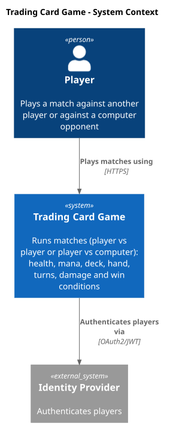

# Chapter 3: System Scope and Context

## 3.1 System Scope

The **Trading Card Game** system manages everything needed to run the full player lifecycle and a match: player registration and login (credentials stored in SQLite with hashed passwords), match lifecycle (create, join, play turns, resolve win/loss), game state (health, mana, deck, hand), and rule enforcement (Bleeding Out, Overload, Dud). There is no external Identity Provider; authentication is entirely internal.

## 3.2 System Context

The diagram below shows the system as a black box, together with the people and external systems it interacts with.

### Interactions

| From | To | Interaction | Protocol |
|------|----|-------------|----------|
| Player | Trading Card Game | Registers a new account, logs in, creates and joins matches, plays cards, views game state | HTTPS |

## 3.3 Scope Boundaries

### Inside scope

- Player registration and login (accounts stored in SQLite, passwords hashed with bcrypt, session tokens issued on login)
- Match creation and joining (PvP and PvC modes)
- Full turn engine: mana slot gain, mana refill, card draw, card play, damage resolution
- Special rule enforcement: Bleeding Out, Overload, Dud
- Computer opponent logic (PvC)
- Persistence of match state across turns
- REST API and React SPA

### Outside scope

- Card collection management, trading, or deck building (the deck is fixed by the kata)
- Leaderboards, match history, or statistics beyond the current match
- Real-time push notifications (turn changes are polled or requested by the client)
