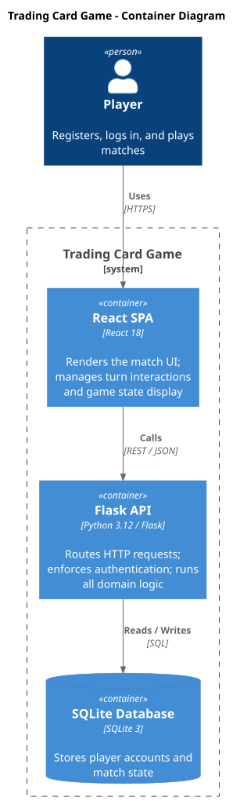
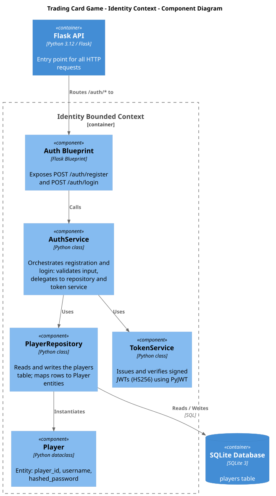
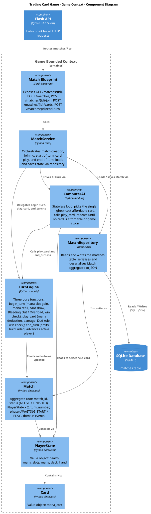

# Chapter 5: Building Block View

## 5.1 Level 1 — System (White-Box)

The system is a single deployable unit composed of three containers: a React SPA served to the browser, a Flask API, and a SQLite database. The domain logic (turn engine, rules, AI) runs as modules inside the Flask API process — it is not a separate container.

| Container | Technology | Responsibility |
|---|---|---|
| **React SPA** | React 18 | Renders the match UI; manages turn interactions and game state display in the browser |
| **Flask API** | Python 3.12 / Flask | Routes HTTP requests; enforces authentication via JWT; runs all domain logic internally |
| **SQLite Database** | SQLite 3 | Persists player accounts (`players` table) and match state (`matches` table) |

The Flask API is the only container that touches the database.

---

## 5.2 Level 2 — Identity Bounded Context (White-Box)

The Identity context owns player registration, login, and JWT token issuance.

| Component | Type | Responsibility |
|---|---|---|
| **Auth Blueprint** | Flask Blueprint | Exposes `POST /auth/register` and `POST /auth/login`; deserialises request JSON; serialises responses |
| **AuthService** | Python class | Orchestrates registration (uniqueness check, password hashing) and login (password verification, token issuance) |
| **PlayerRepository** | Python class | Maps between `players` table rows and `Player` entities; the only component that executes SQL for this context |
| **TokenService** | Python class | Issues and verifies HS256-signed JWTs using `PyJWT`; encodes `player_id` and `exp` claims |
| **Player** | Python dataclass | Entity — fields: `player_id`, `username`, `hashed_password` |

### Registration flow

1. `Auth Blueprint` receives `POST /auth/register {username, password}`.
2. `AuthService` asks `PlayerRepository` whether the username is already taken.
3. If free, `AuthService` hashes the password with bcrypt and calls `PlayerRepository.save(player)`.
4. Response: `201 Created`.

### Login flow

1. `Auth Blueprint` receives `POST /auth/login {username, password}`.
2. `AuthService` loads the `Player` via `PlayerRepository`, verifies the password with bcrypt.
3. On success, `TokenService` issues a signed JWT containing `player_id` and an expiry.
4. Response: `200 OK { "token": "<jwt>" }`.

---

## 5.3 Level 2 — Game Bounded Context (White-Box)

The Game context owns match creation, joining, turn execution, rule enforcement, and computer AI.

| Component | Type | Responsibility |
|---|---|---|
| **Match Blueprint** | Flask Blueprint | Exposes `GET /matches/{id}`, `POST /matches`, `POST /matches/{id}/join`, `POST /matches/{id}/cards`, `POST /matches/{id}/end-turn`; validates the JWT on every request |
| **MatchService** | Python class | Orchestrates match creation, joining, start-of-turn, card play, and end-of-turn; loads and persists `Match` aggregates via `MatchRepository` |
| **MatchRepository** | Python class | Serialises `Match` aggregates to JSON for storage and deserialises them on load; executes SQL against the `matches` table |
| **TurnEngine** | Python module | Three pure functions: `begin_turn(match) → Match` (mana slot gain, mana refill, card draw with Bleeding Out / Overload; win condition check after Bleeding Out damage); `play_card(match, card) → Match` (mana deduction, damage, Dud rule, win condition check); `end_turn(match) → Match` (emits `TurnEnded`, advances active player) |
| **ComputerAI** | Python module | Stateless loop: repeatedly picks the single highest-cost card the computer can still afford, calls `TurnEngine.play_card`, and repeats until no affordable card remains or the game is won |
| **Match** | Python dataclass | Aggregate root — `match_id`, `status` (`ACTIVE` / `FINISHED`), two `PlayerState` objects, `turn_number`, `phase` (`AWAITING_START` / `PLAY`), list of domain events |
| **PlayerState** | Python dataclass | Value object — `health`, `mana_slots`, `mana`, `deck`, `hand` |
| **Card** | Python dataclass | Value object — `mana_cost` |

### Turn execution flow

A turn has two phases. The start-of-turn phase runs automatically when the previous turn ends (or when the match begins); the player then sees their updated state before choosing which cards to play.

**Phase 1 — Start of turn (automatic)**

1. When `POST /matches/{id}/end-turn` (or match creation for the opening hand) is processed, `MatchService` calls `TurnEngine.begin_turn(match)`:
   - Gain one mana slot (max 10).
   - Refill mana to current mana slots.
   - Draw one card: if deck is empty, apply Bleeding Out (1 damage); if hand is already 5 cards, apply Overload (drawn card discarded).
   - Check win condition: if Bleeding Out reduced the active player's health to ≤ 0, set `Match.status` to `FINISHED` and raise `GameWon`.
2. If the match is not finished, `Match.phase` is set to `PLAY` and the updated state is saved. The player can now see their hand and mana before acting.

**Phase 2 — Card play (player-driven)**

3. The player calls `POST /matches/{id}/cards {card_index: N}` for each card they wish to play.
4. `MatchService` verifies it is the player's turn and the match is in `PLAY` phase, then calls `TurnEngine.play_card(match, card)`:
   - Verify the player has enough mana.
   - Deduct the card's mana cost.
   - Deal damage equal to mana cost (0-mana cards deal no damage — Dud rule).
   - Check win condition; if met, set `Match.status` to `FINISHED`.
5. State is saved after each card; multiple cards may be played in sequence.

**End of turn**

6. The player calls `POST /matches/{id}/end-turn`.
7. `MatchService` calls `TurnEngine.end_turn(match)`, which emits `TurnEnded` and advances the active player pointer.
8. `MatchService` immediately calls `TurnEngine.begin_turn(match)` for the opponent (Phase 1 of the opponent's turn), saves the result, and returns the full updated state.
9. If the opponent is the computer, `ComputerAI` runs its loop immediately: it picks the highest-cost card it can still afford, calls `TurnEngine.play_card`, and repeats until no card is affordable or the game is won. It then calls `TurnEngine.end_turn` and `TurnEngine.begin_turn` for the human, so the response already contains the human's new hand and mana.
10. Response: `200 OK` with the full updated game state.

### Domain events raised by TurnEngine

| Event | Trigger |
|---|---|
| `CardPlayed` | A card is successfully played |
| `PlayerDamaged` | A player's health decreases |
| `CardDiscarded` | Overload rule fires |
| `BleedingOut` | A player draws from an empty deck |
| `TurnEnded` | Active player's turn completes |
| `GameWon` | A player's health reaches ≤ 0 (checked in both `begin_turn` after Bleeding Out and `play_card` after damage) |
