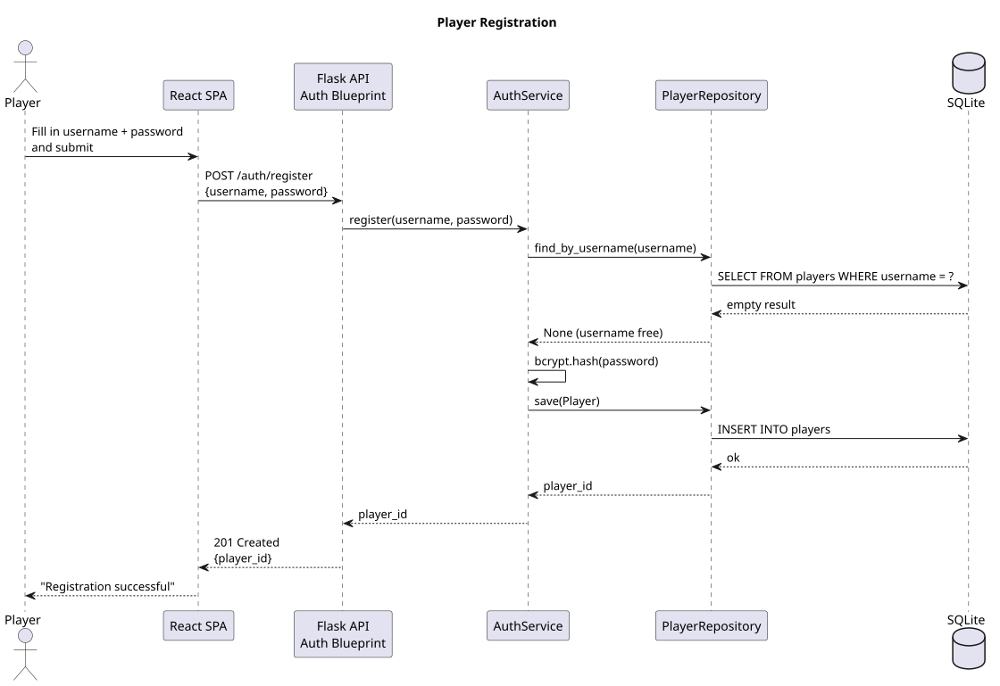
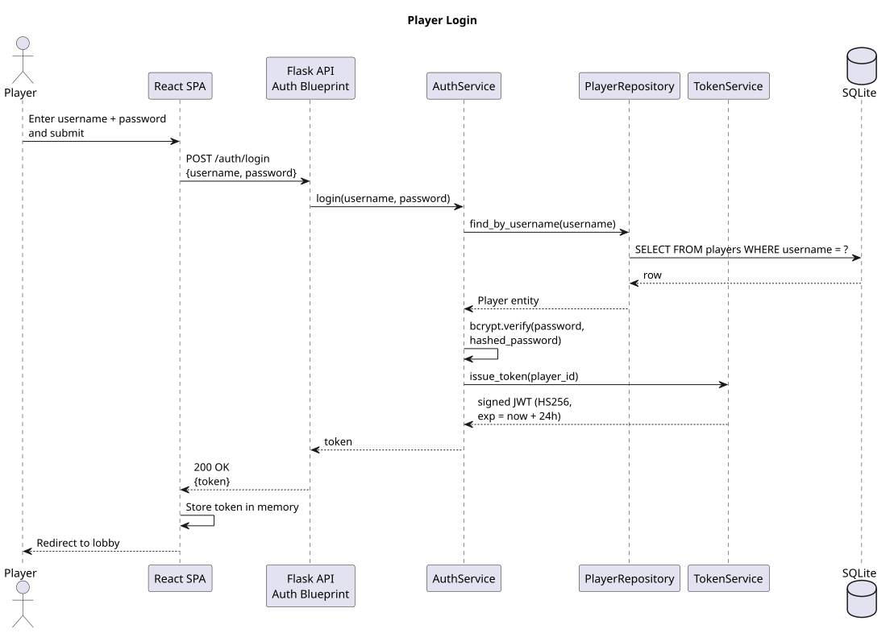
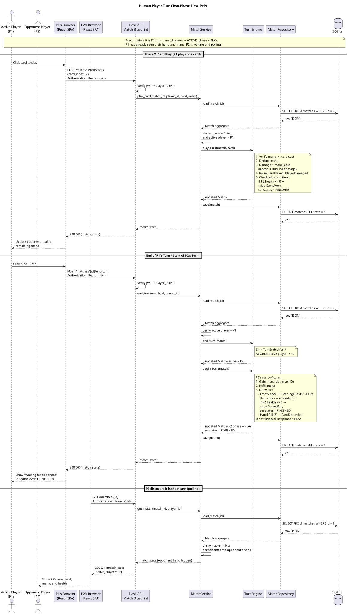
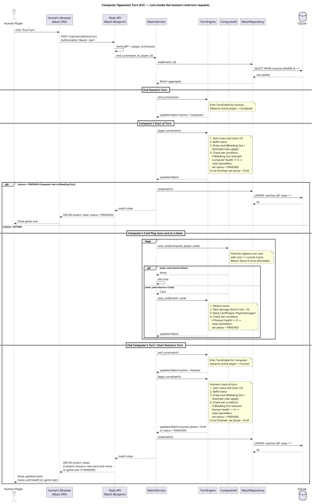

# Chapter 6: Runtime View

This chapter shows the system's behaviour at runtime for three key scenarios: player registration, player login, and a full two-phase player turn (both human and computer sides).

---

## 6.1 Player Registration

The player submits a username and password. The Auth Blueprint delegates to `AuthService`, which checks uniqueness via `PlayerRepository`, hashes the password with bcrypt, and persists the new `Player`. No token is issued at registration; the player must log in separately.

**Error paths (not shown):**
- Username already taken → `409 Conflict`.
- Missing or blank fields → `400 Bad Request` (request validation before `AuthService` is called).

---

## 6.2 Player Login

The player submits credentials. `AuthService` loads the `Player` from the database, verifies the password with bcrypt, and asks `TokenService` to issue a signed JWT. The SPA stores the token in memory and includes it as a `Bearer` header on all subsequent requests.

**Error paths (not shown):**
- Username not found or password wrong → `401 Unauthorized` (same response for both; no enumeration of valid usernames).
- Token already expired on a later request → `401 Unauthorized`.

---

## 6.3 Human Player Turn (Two-Phase Flow)

A turn is split into two phases so the player always sees the drawn card and refreshed mana before deciding which cards to play.

**Phase 2 — Card play (one `POST /matches/{id}/cards` per card):**
Each call runs `TurnEngine.play_card` for the active player: verifies mana, deducts cost, deals damage (Dud rule for 0-cost cards), and checks the win condition. State is persisted after every card, so a disconnection mid-turn does not lose progress.

**End of turn / start of opponent's turn:**
When the active player calls `POST /matches/{id}/end-turn`, `MatchService` calls `TurnEngine.end_turn` for that player (emitting `TurnEnded` and advancing the active player pointer to the opponent), then immediately calls `TurnEngine.begin_turn` for the opponent. `begin_turn` gains the opponent's mana slot, refills their mana, and draws their card, applying Bleeding Out or Overload as needed. If Bleeding Out reduces the opponent's health to ≤ 0, `begin_turn` raises `GameWon` and sets `Match.status` to `FINISHED` — the opponent loses at the start of their own turn without getting to play. Otherwise, the match is saved with the opponent as active player in `PLAY` phase and the response contains the full updated state so the opponent's SPA can display their new hand and mana straight away.

**Error paths (not shown):**
- Not the player's turn → `403 Forbidden`.
- Insufficient mana for the chosen card → `422 Unprocessable Entity`.
- Match already finished → `409 Conflict`.

---

## 6.4 Computer Opponent Turn (PvC)

The computer's entire turn runs synchronously inside the same HTTP request as the human's `POST /matches/{id}/end-turn`. No second request is needed.

After ending the human's turn, `MatchService` calls `TurnEngine.begin_turn` for the computer (mana slot gain, mana refill, card draw). If Bleeding Out fires and reduces the computer's health to ≤ 0, `begin_turn` raises `GameWon`, the match is saved as `FINISHED`, and the response is returned immediately — the computer loses at the start of its turn without playing any cards. Otherwise, `MatchService` enters a loop driven by `ComputerAI.next_card`: on each iteration, `ComputerAI` inspects the computer's current `PlayerState` and returns the single highest-cost card it can still afford, or `None` if no card is affordable. `MatchService` calls `TurnEngine.play_card` for each returned card, which deducts mana and deals damage, so mana is correctly reduced before the next card is selected. The loop exits when `ComputerAI` returns `None` or the win condition is met.

After the loop, `MatchService` calls `TurnEngine.end_turn` for the computer, then `TurnEngine.begin_turn` for the human player, so the single response already contains the human's new hand and mana for their next turn.
