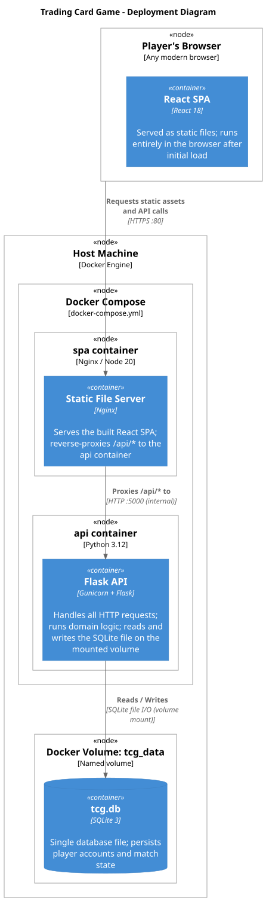

# Chapter 7: Deployment View

## 7.1 Overview

The system runs as two Docker containers orchestrated by Docker Compose. The SQLite database is not a container; it is a `.db` file on a named Docker volume mounted into the `api` container. This setup covers local development and CI. The hosting target for any shared or production environment has not been decided; the Docker Compose configuration is the authoritative deployment unit until that decision is made.



---

## 7.2 Containers

| Container | Base image | Exposed port | Purpose |
|---|---|---|---|
| `spa` | `node:20-alpine` (build) → `nginx:alpine` (serve) | 80 (host) | Serves the built React SPA as static files; reverse-proxies `/api/*` to the `api` container |
| `api` | `python:3.12-slim` | 5000 (internal only) | Runs the Flask application under Gunicorn; mounts the `tcg_data` volume and reads/writes `tcg.db` directly |

The `api` container is not reachable directly from the browser. All traffic enters through Nginx in the `spa` container. The SQLite file lives on the `tcg_data` named volume, which persists across container restarts.

---

## 7.3 Docker Compose Structure

```yaml
# docker-compose.yml (illustrative — not the authoritative source)
services:
  spa:
    build:
      context: ./frontend
      dockerfile: Dockerfile          # multi-stage: node build → nginx serve
    ports:
      - "80:80"
    depends_on:
      - api

  api:
    build:
      context: ./backend
      dockerfile: Dockerfile          # python:3.12-slim, gunicorn entrypoint
    environment:
      - JWT_SECRET=${JWT_SECRET}
      - DATABASE_PATH=/data/tcg.db
      - FLASK_ENV=${FLASK_ENV:-production}
    volumes:
      - tcg_data:/data
    expose:
      - "5000"

volumes:
  tcg_data:
```

Secrets (e.g. `JWT_SECRET`) are injected via environment variables and never committed to the repository.

---

## 7.4 Local Development

```
docker compose up --build
```

This single command builds both images and starts both containers. The SPA is available at `http://localhost:80`. Hot-reload in development mode can be enabled by mounting the source tree into the containers and switching to the Flask development server.

---

## 7.5 Future Hosting

No hosting target has been decided. The Docker Compose file is portable to any container-capable host (a single VM, a managed container service, etc.). When a target is chosen, this chapter will be updated with the production topology, TLS termination, and secret management approach.
